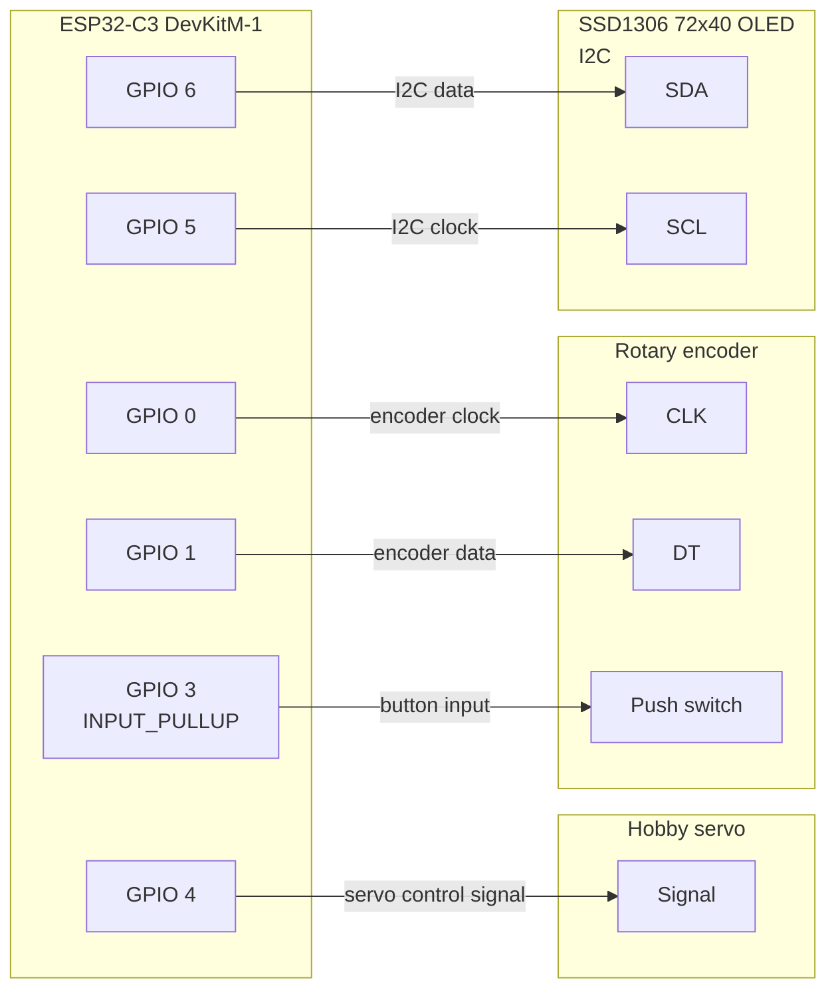
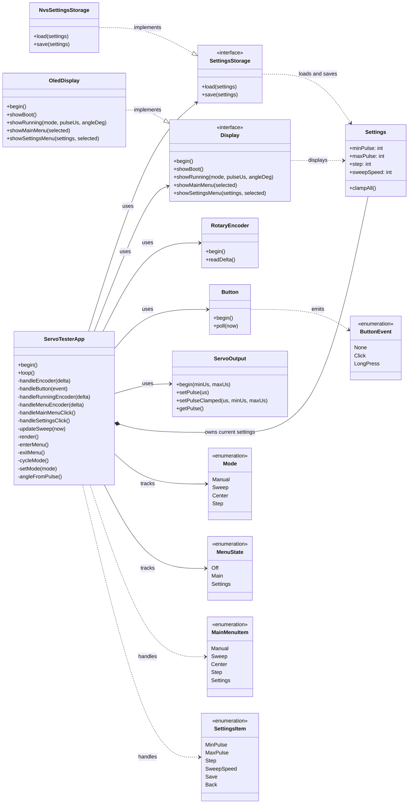
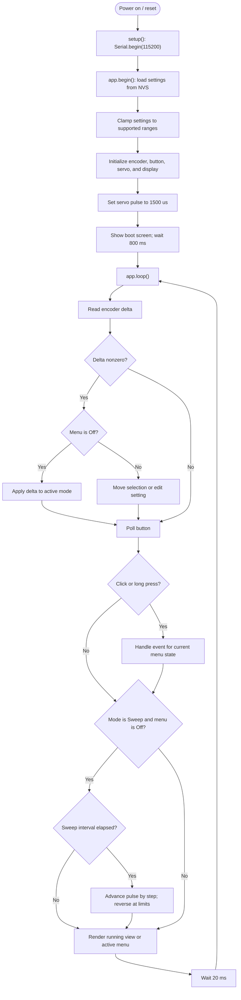

# Servo Tester Diagrams

These diagrams are based on the current source, especially `src/main.cpp` and
`src/ServoTesterApp.cpp`. Mermaid diagrams render on GitHub.

## Principal wiring

Signal pin assignments are taken from `src/main.cpp`. The firmware does not
define power connections; follow the requirements of the specific board,
display, and servo. If the servo uses a separate supply, its ground must be
connected to ESP32 ground.

## UML class diagram

`main.cpp` creates the concrete hardware adapters and injects them into
`ServoTesterApp`. The diagram shows the application classes and their key
public and internal methods; external library internals are omitted.

## UML-style application workflow

The startup path and recurring application loop are represented as an
activity-style flow. The loop polls controls, updates the sweep if active,
draws the screen for the current menu state, then waits 20 ms.

### Input and menu behavior

- On the running screen, turning the encoder edits the current mode's value.
  In Step mode, a button click advances the servo by one step; in other modes
  it cycles to the next mode.
- A long press opens the main menu. A main-menu click selects a mode or opens
  Settings; a long press returns to the running screen.
- In Settings, turning the encoder edits the selected value. A click advances
  to the next item, saves when **Save** is selected, or returns without saving
  when **Back** is selected. A long press returns to the main menu.
