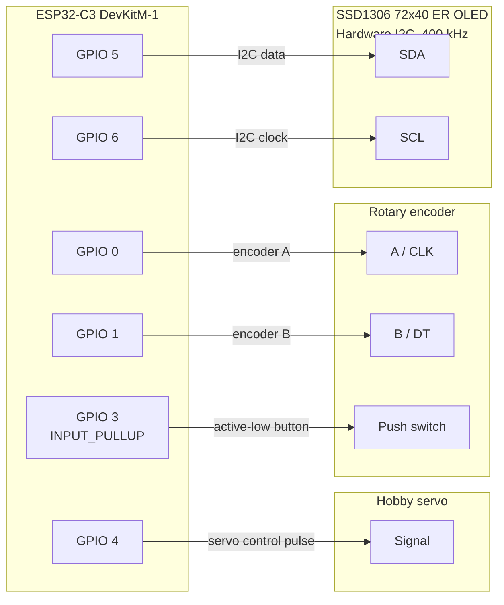
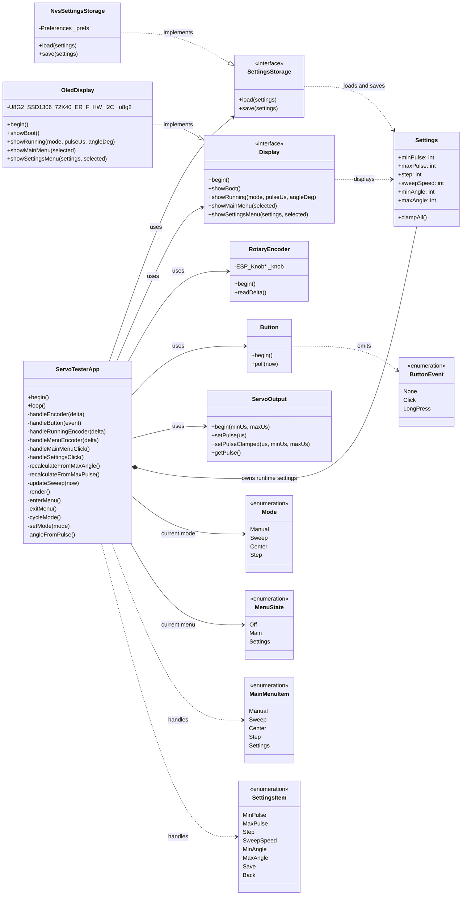
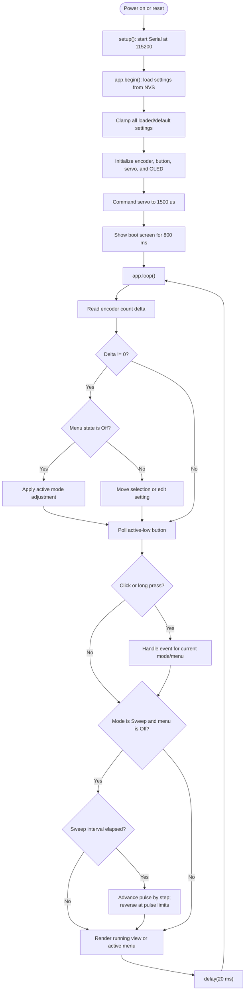

# Servo Tester Diagrams

These diagrams describe the current firmware in `src/`. Mermaid diagrams
render on GitHub.

## Principal signal wiring

Signal pin assignments and the OLED bus clock are defined in `src/main.cpp`
and `src/OledDisplay.cpp`. Power pins are intentionally not specified: supply
requirements depend on the exact board, OLED, and servo. Use a suitable servo
supply; if it is separate, connect its ground to ESP32 ground.

## UML class diagram

`main.cpp` constructs the concrete adapters and injects them into
`ServoTesterApp`. External Arduino and library classes are shown only where
they clarify an adapter's implementation.

## Application workflow

### Input and persistence details

- In Manual mode, encoder rotation changes pulse width by `step`; in Sweep
  mode it changes the interval by 1 ms; in Step mode it changes `step` by 1
  µs; Center ignores encoder rotation.
- A short press cycles mode except in Step mode, where it advances the pulse
  by `step`. Selecting Center commands the pulse-range midpoint. A long press
  opens the main menu from the running screen.
- The main-menu selection wraps. In Settings, a click on a numeric item
  advances to the next item; **Save** persists to NVS, while **Back** and
  long-press return to the main menu without saving.
- Settings defaults are `minPulse=500`, `maxPulse=2500`, `step=10`,
  `sweepSpeed=20`, `minAngle=0`, and `maxAngle=180`.
- Startup/storage clamps are `minPulse=0–1500`, `maxPulse=1500–3500`,
  `step=1–50`, `sweepSpeed=5–100`, `minAngle=0–180`, and `maxAngle=90–360`.
  The interactive pulse-edit ranges are narrower: `minPulse=500–1500` and
  `maxPulse=1500–2500`; all menu adjustments use the increments described in
  [USER_MANUAL.md](USER_MANUAL.md).
- The angle display uses Arduino `map()` to map `minPulse..maxPulse` to
  `0..maxAngle`; `minAngle` is not used by that displayed-angle calculation.
  The pulse/angle settings handlers also call recalculation methods when those
  values are edited. The display is command-derived, not position feedback.
