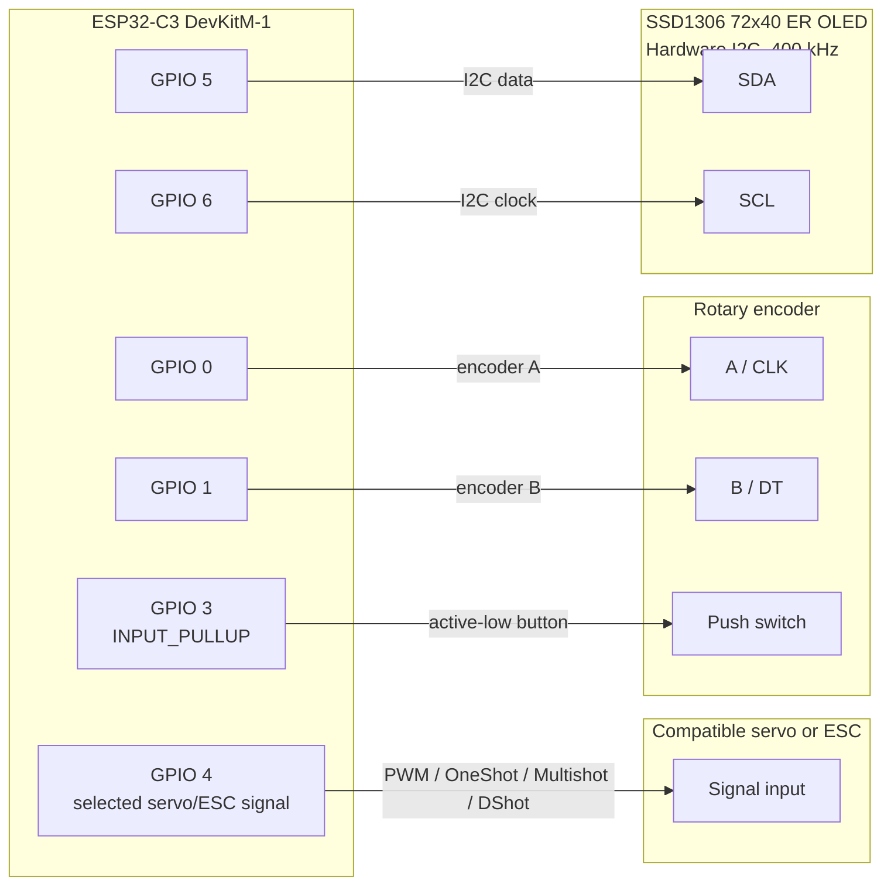
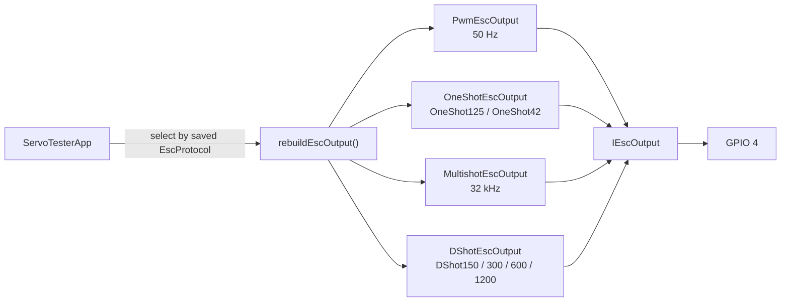
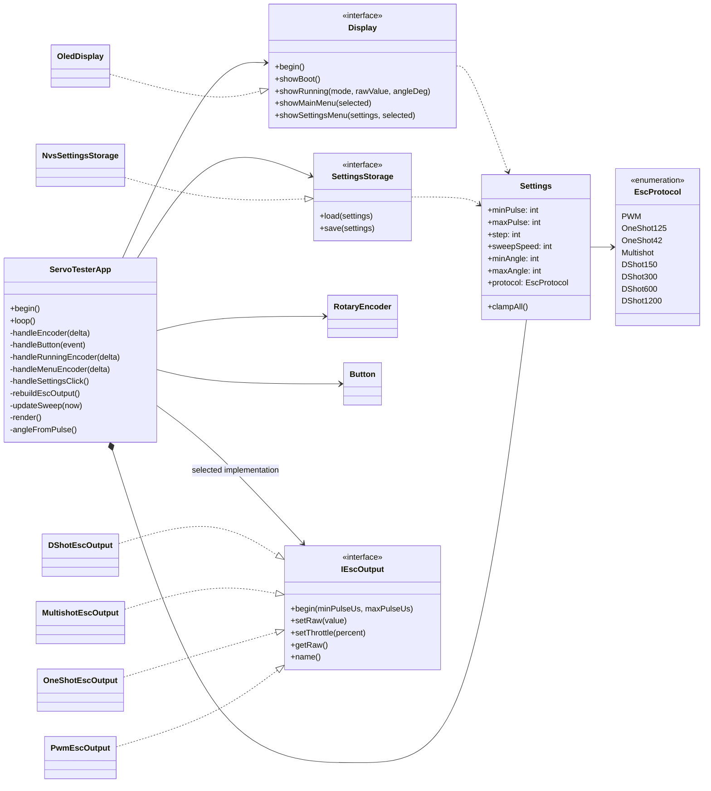
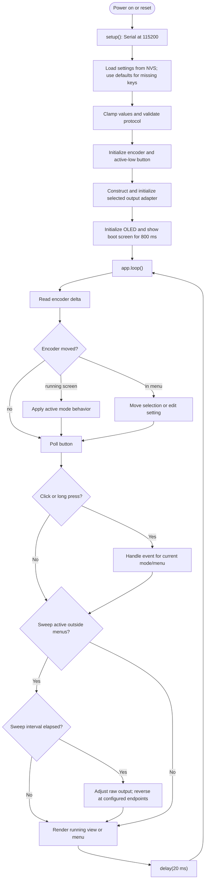

# ServoTester Diagrams

These diagrams describe the current firmware in `src/`. Mermaid diagrams
render on GitHub.

## Principal signal wiring

GPIO assignments are defined in `src/main.cpp`; the OLED bus clock is set in
`src/OledDisplay.cpp`. GPIO 4 is a signal output only. Power wiring depends
on the specific ESP32 board, display, servo, and ESC; observe their manuals
and connect signal grounds as required. Remove propellers or mechanical loads
when testing ESC outputs.

## Output adapter selection

Current limitation: the app supplies raw values constrained by shared
min/max settings; it does not normalize those values across adapter-specific
domains. See [USER_MANUAL.md](USER_MANUAL.md) before using non-PWM protocols.

## UML class diagram

`main.cpp` constructs storage, display, encoder, and button dependencies.
`ServoTesterApp` constructs the selected output adapter.

## Application workflow

## Input and persistence notes

- Running mode cycle: **Manual → Sweep → Center → Step → Manual**.
- Manual adjusts output by `delta * step`; Sweep adjusts interval; Step
  adjusts step size; Center ignores encoder rotation.
- A click cycles mode except in Step mode, where it advances output once.
  Selecting Center commands the configured min/max midpoint.
- A long press opens the main menu. In Settings, a click advances to the next
  item; **Save** persists settings, while **Back** and long press leave
  without saving.
- Settings defaults are `minPulse=1000`, `maxPulse=2000`, `step=10`,
  `sweepSpeed=20`, `minAngle=0`, `maxAngle=120`, and `protocol=PWM`.
- NVS namespace is `servo`. Protocol values are stored as enum integers;
  invalid values are clamped back to PWM.
- The displayed angle maps the raw output from configured min/max to
  `0..maxAngle`. It does not use `minAngle` and is not position feedback.
- The output adapters have different raw domains. The app currently does not
  convert the shared min/max values and step size to each protocol's native
  range; this limits non-PWM behavior.
